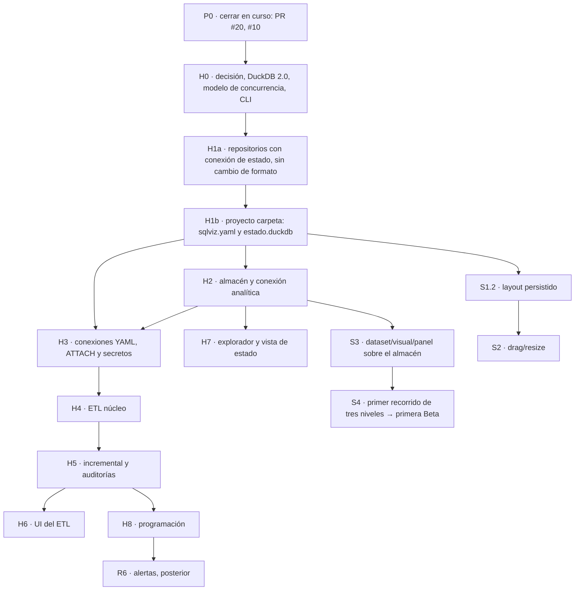

# Integración de proyecto como código, almacenes y ETL ligero — propuesta

**Fecha:** 2026-10-25. **Estado:** propuesta pendiente de aprobación. No cambia
por sí sola las decisiones aceptadas, el [plan operativo del Studio](sqlviz-studio-delivery-plan.md)
ni el [roadmap de releases](sqlviz-release-roadmap.md). Analiza dos documentos
aportados por el usuario: `prompt-etl-almacen-sqlviz.md` (arquitectura y fases 0–6)
y `roadmap-etl-almacen-sqlviz.md` (hitos H0–H9), contra la planificación vigente,
el CHANGELOG y el código en `45fbf98`.

Se distinguen **observado** (código, pruebas o documentación oficial),
**decidido** (aceptado por el usuario en documentos vigentes), **hipótesis por
validar** y **propuesta** de este documento.

## Dictamen

La nueva arquitectura **resuelve problemas que la planificación vigente ya
reconocía como pendientes**: separar metadatos y datos analíticos (SEC-02,
DATA-04), dejar de copiar tablas a Parquet en cada consulta y disponer de
fuentes, conexiones y definiciones versionables. Adelantarla antes de S3 es
coherente: el dataset reutilizable de S3 debe diseñarse sobre el almacén
analítico definitivo, no sobre el snapshot por consulta.

Recomiendo adoptarla con **cuatro ajustes de fondo** antes de la Fase 1:

1. **Modelo de concurrencia del almacén.** En DuckDB 2.0.0 no es posible lo que
   el prompt supone: una conexión analítica `READ_ONLY` con acceso externo
   desactivado conviviendo, en el mismo proceso, con un escritor ETL sobre el
   mismo `almacen.duckdb`. Ver [hallazgos verificados](#hallazgos-verificados-en-duckdb-200).
   Hay que elegir un modelo antes de H2.
2. **Dónde viven tableros y paneles** en un proyecto carpeta mientras «tableros
   como archivos» sigue siendo posterior. El prompt no lo asigna a ninguna capa.
3. **Un solo esquema de aplicación para los dos modos.** El modo legado `.sqlviz`
   y el modo carpeta deben compartir repositorios y migraciones; si no, cada
   repositorio y cada prueba se duplican hasta H9.
4. **CLI con subcomandos sin romper `sqlviz PROYECTO`.** Hoy el primer argumento
   posicional es el proyecto: `sqlviz plan` abriría un proyecto llamado `plan`.

Sin esas decisiones, H1–H3 producirían dos almacenamientos paralelos y un
aislamiento analítico más débil que el actual.

## Base revisada

Planificación: [índice](../README.md), [plan de entregas](sqlviz-product-roadmap.md),
[plan del Studio](sqlviz-studio-delivery-plan.md), [roadmap de releases](sqlviz-release-roadmap.md),
[decisión de recursos](sqlviz-project-resources-decision.md),
[evaluación del informe v2](sqlviz-report-v2-assessment.md),
[arquitectura objetivo](sqlviz-product-architecture.md),
[especificación del Studio](sqlviz-dashboard-studio-spec.md),
[ejecución analítica](sqlviz-analytical-execution.md), [autorización](sqlviz-authorization.md),
[arranque local](sqlviz-local-startup.md), [auditoría](sqlviz-audit-2026-10-05.md),
[buenas prácticas](sqlviz-engineering-practices-review.md) y el
[CHANGELOG](../../CHANGELOG.md). De DOC2, DOC3, autoría, mapa, matriz e inferencia
semántica se revisaron las secciones de almacenamiento, CLI, conexiones,
datasets y alcance ETL.

Código consultado: `sqlviz_storage` (`schema.py`, `migrations.py`, `auth.py`,
`sharing.py`, `secrets.py`, `brain_db.py`), `sqlviz_api/services` (`queries.py`,
`query_policy.py`, `access.py`), `sqlviz_cli` y la integración `drawflowMap.ts`.

### Estado observado relevante

| Pieza | Estado actual | Relación con la propuesta |
| --- | --- | --- |
| `.sqlviz` | Un archivo DuckDB con 11 tablas de aplicación (`APPLICATION_TABLES`) y posibles tablas del usuario; 23 migraciones | Se divide en estado y almacén |
| Credencial admin y enlaces | `_sqlviz_auth` y `shares` en el `.sqlviz` | Pasan al almacén de estado |
| Sesiones admin/lector | **En memoria** por aplicación (`SessionStore`); reiniciar las invalida | El prompt las mueve al estado: ver [conflictos](#conflictos-con-trabajo-en-curso-o-planificado) |
| Aprendizaje | `~/.sqlviz/brain.duckdb`, **uno por máquina**, conexión global (DATA-04) | El prompt lo pasa al estado **por proyecto** |
| Recibos de Run | HMAC con clave en memoria, expiran en 15 min | Sin cambio |
| Conexiones | Tabla `connections` y `secrets.py` (secretos DuckDB, solo postgres/mysql) **sin uso** desde la API | Se reemplazan por `conexiones/*.yaml` y secretos temporales |
| Consulta analítica | Catálogo `:memory:` por operación; copia a Parquet de tablas referenciadas; tope de 100 000 filas y 64 MiB; rechaza referencias con catálogo y vistas | Se reemplaza por consulta directa al almacén |
| Archivos locales | `--data-dir` (#19, PR #20 abierto) permite leer carpetas autorizadas | Puente hasta conexiones de tipo archivo |
| Quack | Opt-in, sirve la conexión del proyecto completo | Queda solo para el almacén, posterior |
| DuckDB | Fijado en **1.5.4** (`uv.lock`); 1.5.6 y **2.0.0** (21/10/2026) publicados; existe `2.0.1.dev` | H0 |
| Trabajo abierto | F1: #10 (3d), #11–#16 (layout persistido), #19/PR #20 | Ver orden unificado |

## Hallazgos verificados en DuckDB 2.0.0

Pruebas ejecutables en un entorno aislado (`uv run --no-project --with duckdb==2.0.0`),
con datos sintéticos de un millón de filas. Ningún archivo del proyecto ni del
usuario se modificó.

| # | Comprobación | Resultado observado |
| --- | --- | --- |
| 1 | `BEGIN; CREATE OR REPLACE TABLE …; ROLLBACK` | Se revierte: la tabla conserva sus filas |
| 2 | Instancia `:memory:` con `ATTACH 'almacen.duckdb' (READ_ONLY)`, acceso externo desactivado y configuración bloqueada | Lee 1 M de filas; `INSERT` rechazado; `ATTACH` del estado y lectura de archivos dan `PermissionException` |
| 3 | `DETACH almacen` con `lock_configuration = true` | **Permitido.** Solo la política de sentencias lo impide hoy |
| 4 | Segunda instancia que adjunta `almacen.duckdb` mientras otra lo tiene abierto, mismo proceso | **`ResourceInUseException`**: un archivo pertenece a una sola instancia por proceso |
| 5 | El mismo archivo adjuntado dos veces (RW y `READ_ONLY`) en una instancia | Rechazado por la misma razón |
| 6 | `enable_external_access` por sesión | **No admitido**: es global de la instancia |
| 7 | Una instancia con almacén RW y fuente SQLite adjuntada antes del bloqueo | El ETL sigue leyendo la fuente adjunta; un `ATTACH` nuevo falla; **un cursor «analítico» puede escribir**; `memory_limit` es global |
| 8 | Lectura concurrente con cursores durante una transacción de escritura | Aislamiento de snapshot correcto: el lector ve el estado confirmado |
| 9 | DuckDB 1.5.4 abriendo un archivo escrito por 2.0.0 | Rechazado (`storage_version v2.0.0+`) |
| 10 | `allowed_directories` | Disponible en 2.0.0 |

**Consecuencia (observado):** el diseño «conexión analítica `READ_ONLY` separada
+ escritor ETL en el mismo proceso» no es realizable tal como está descrito.
Las opciones reales son:

| Opción | Cómo funciona | Garantías | Coste |
| --- | --- | --- | --- |
| **A. Instancia única dueña del almacén** | Una instancia con almacén RW; fuentes adjuntadas al arrancar; acceso externo off y configuración bloqueada; ETL y consultas usan cursores | Lectura del estado y de archivos bloqueada por el motor. **Escritura y `DETACH` solo bloqueadas por la política de sentencias.** Memoria y hilos compartidos | Añadir o cambiar una conexión exige reabrir la instancia; presupuestos de memoria globales, no por consulta |
| **B. Lector y escritor alternados** | Instancia lectora `READ_ONLY`; durante `aplicar` se cierra, abre el escritor y luego se reabre | Motor impide escrituras analíticas | Tableros sin datos mientras dura `aplicar`; inaceptable con cargas largas |
| **C. DuckLake como almacén** | Catálogo DuckLake con lectores y escritor separados | Lectores `READ_ONLY` independientes | El prompt lo deja como destino posterior; requiere su propia verificación |

**Propuesta:** opción **A** para H2, reforzada con: política de sentencias que
rechace también `DETACH`, `ATTACH`, `SET`, `COPY`, `EXPORT`, `PRAGMA` y funciones
de escritura; pruebas negativas por cada una; documentar que el límite de
memoria por consulta pasa a ser de instancia. Mantener la opción C como
evolución cuando haya varios escritores o lectores externos. Esta elección es
una de las [decisiones pendientes](#decisiones-que-requieren-al-usuario).

## Qué coincide, qué se solapa y qué queda reemplazado

### Coincide con lo ya decidido o pendiente

| Planificación vigente | Nueva arquitectura |
| --- | --- |
| Arquitectura §4: separar metadatos y datos analíticos; «no adjuntar la base de metadatos a conexiones analíticas» | Estado y almacén separados; la conexión analítica nunca ve el estado |
| Ejecución analítica, límites pendientes: «falta almacenamiento analítico propio, adaptadores, revisiones, frescura» | H2 reemplaza el snapshot por consulta |
| Auditoría SEC-02 (cerrado por aislamiento) y DATA-04 (brain global) | Estado por proyecto y almacén propio |
| Recursos R4: definiciones exportables SQL/JSON/YAML, sin secretos, revisables en Git | Proyecto como código, adelantado y más amplio |
| Recursos R5a/R5b: conexión/fuente, adaptador prioritario, credenciales, ingesta acotada | H3 (conexiones y `ATTACH`) |
| E3: CSV/Parquet y PostgreSQL como conector prioritario | Conexiones `postgres`, `sqlite`, `duckdb`; semillas CSV |
| E5: refresh programado, materializaciones, historial | H4–H8 |
| R6b: scheduler con zona horaria, registro durable, deduplicación | H8 comparte infraestructura: ejecuciones, bloqueo e intervalos |
| DOC3 §4: patrón `ATTACH` para fuentes externas | Se conserva, generado desde YAML |

### Se solapa y hay que unificar

| Tema | Riesgo | Propuesta |
| --- | --- | --- |
| «Modelo» ETL frente a «dataset/modelo» de la decisión de recursos («un modelo SQL es la definición del dataset, no otra copia») | Dos conceptos con el mismo nombre y dos SQL canónicos | **Modelo** = transformación que materializa una relación en el almacén. **Dataset** (S3) = consulta de presentación sobre relaciones del almacén. Un dataset referencia tablas, no copia el SQL del modelo |
| Grafo del ETL frente al [Mapa vivo](sqlviz-dashboard-map-spec.md) (que excluye editar pipelines) | Dos grafos de dependencias | Dos vistas de un mismo linaje: el Mapa llega hasta la relación del almacén y enlaza al grafo ETL («Origen») |
| Explorador de datos frente a la biblioteca R2 | Dos catálogos | Biblioteca = recursos SQLviz (datasets, visuales, tableros); explorador = catálogo físico (bases → esquemas → tablas). Enlazados, sin duplicar identidad |
| Consola SQL del explorador frente al editor multiconsulta del Studio | Dos editores con reglas distintas | Ambos pasan por `QueryService`; la consola no crea paneles hasta «abrir como tablero» con el flujo existente |
| Política Live/materializado del informe v2 | Duplicar políticas | El ETL es la materialización; Live = consulta directa a una fuente adjunta |
| `--data-dir` (#19) | Dos formas de leer archivos | Mantener como puente; en H3 se expresa como conexión de tipo archivo y `--data-dir` se depreca |
| `QueryService` y sus presupuestos | Perder límites al quitar la copia | Conservar tiempo, filas, bytes y concurrencia; memoria pasa a ser de instancia (opción A) |

### Queda reemplazado

| Hoy | Reemplazo | Cuándo |
| --- | --- | --- |
| Copia a Parquet por consulta, `max_source_rows`, `max_snapshot_bytes` | Consulta directa al almacén | H2 (solo modo carpeta; el legado conserva la copia hasta H9) |
| Rechazo de referencias con catálogo | Referencias `base.esquema.tabla` a bases autorizadas | H2/H3 |
| Tabla `connections` y `secrets.py` (secretos sin uso) | `conexiones/*.yaml`, `${VARIABLE}` y secretos temporales | H3 |
| `.sqlviz` como único formato | Carpeta de proyecto | Coexisten hasta H9 |
| Afirmaciones vigentes de prioridad: «ETL general/orquestador fuera de prioridad» (plan de entregas), «no se amplía a ETL general… mientras el recorrido esté incompleto» (especificación del Studio), «Polars, DAG de transformaciones… extensiones posteriores» (plan del Studio), R5–R7 «después de S8» | Decisión nueva del usuario que las revierte para este alcance | Al aprobar esta propuesta |

## Conflictos con trabajo en curso o planificado

| Trabajo | Conflicto | Recomendación |
| --- | --- | --- |
| **PR #20, `--data-dir` (#19)** | Ninguno; es un puente útil ahora | **Terminar**: fusionar |
| **#10, S1.1c.2c.3d** recuperación de respuesta perdida | Persiste IDs de operación en el `.sqlviz`; en el modo carpeta irían al estado | **Terminar** con repositorio que reciba la conexión de estado; cierra `v0.4.0a1` |
| **#11–#16, layout persistido (S1.2)** | Independiente del almacén, pero define tablas nuevas de tablero que tendrán que vivir en estado o en archivos | **Pausar** hasta H1 si se aprueba el modo carpeta; diseñar el documento de layout como JSON versionado (ya previsto) para que pasar a `tableros/` sea solo serialización |
| **S1.3 bloques de texto, S2 drag/resize** | Independientes del almacén | Reprogramar después de H3 (o intercalar; ver orden) |
| **S3 dataset/visual/panel, matriz M1–M5** | El dataset depende de qué relaciones existen y cómo se consultan | **Adaptar y posponer** hasta después de H2: diseñar sobre el almacén, no sobre el snapshot |
| **S7 cancelación en motor (F7-04)** | Con la opción A, `interrupt()` por cursor sigue disponible | Sin cambio; se beneficia de H2 |
| **R4 bundles (S8)** | El proyecto como código ya hace de bundle para conexiones y modelos | Adaptar: R4 queda para tableros y visuales cuando se migren a archivos |
| **R6 alertas** | Comparten scheduler con H8 | Construir H8 de forma que R6b lo reutilice, sin implementar alertas |
| **Sesiones en el estado** (prompt) | Hoy están en memoria por diseño: reiniciar invalida sesiones y no hay tokens en disco | **No mover**: el estado guarda hash admin, secreto de firma y enlaces. Persistir sesiones solo si hay una necesidad medida |
| **Patrones de feedback en el estado** (prompt) | Cambia el aprendizaje de por máquina a por proyecto | **Fuera de alcance por decisión del usuario (2026-10-25):** el aprendizaje se analiza después de la versión estable. `brain.duckdb` sigue igual y no se mueve al estado |
| **Nombres en español** (prompt) | El código existente usa inglés (`dashboard_repository`, `panels`, `dashboards`) | Español para el dominio nuevo (`sqlviz-transform`, claves YAML, tablas `etl_*`); no renombrar código existente. Registrar la regla |
| **Extensiones** (`postgres`, `sqlite`, DuckLake) | La política vigente prohíbe autoinstalación y descargas | Instalación explícita del operador (comando o guía), igual que Quack |
| **Política de migraciones** | Abrir un `.sqlviz` con 2.0.0 lo hace ilegible para 1.5.x | Copia previa obligatoria antes de abrir con 2.0.0; aplicar también a `brain.duckdb` |
| **CLI** | `sqlviz PROYECTO` posicional choca con `sqlviz plan` | Subcomandos explícitos (`sqlviz abrir`, `plan`, `aplicar`) manteniendo `sqlviz RUTA` como alias cuando la ruta existe o termina en `.sqlviz` |
| **CLI ↔ servidor por HTTP** | El prompt no define cómo se autentica la CLI ante el servidor | Token local de operador en `.sqlviz/`, solo loopback; diseñar en H0 |

## Orden unificado de trabajo

### Dependencias reales

| Bloque | Bloquea a | Motivo |
| --- | --- | --- |
| H0 | Todo | Versión de DuckDB, formato de archivo y modelo de concurrencia condicionan el resto |
| H1a | H1b | Sin repositorios parametrizados por conexión, el modo carpeta duplicaría cada repositorio |
| H1b | H2, H3, S1.2 | El almacén y las conexiones se declaran en `sqlviz.yaml`; el layout necesita saber dónde persistir |
| H2 | H3, H7, S3 | La conexión analítica es la base de bases adjuntas, del explorador y de los datasets |
| H3 | H4 | Los modelos leen fuentes adjuntas |
| H4 | H5 | Intervalos y auditorías se apoyan en DAG, huella, plan y registro |
| H5 | H6, H8 | La UI y la programación muestran y ejecutan intervalos |
| S3 | S4 | Sin cambio respecto al plan vigente |

H6–H8 y S1.2/S2 no dependen entre sí: tras H5 pueden intercalarse.

### Secuencia propuesta y versiones

Respeta la [política vigente](sqlviz-release-roadmap.md#política-de-versiones):
alpha hasta un recorrido usable, una fase por minor y beta al final.

| Fase | Contenido | Versión |
| --- | --- | --- |
| F1 (reducida) | PR #20, #10 | `v0.4.0a1` |
| F2 · Base de proyecto | H0 + H1a + H1b | `v0.5.0a1`, `a2` |
| F3 · Almacén y conexiones | H2 + H3 | `v0.6.0a1`, `a2` |
| F4 · ETL núcleo | H4 + H5 | `v0.7.0a1`, `a2` |
| F5 · Lienzo | S1.2 layout (#11–#16 reubicados), S1.3 texto, S2 drag/resize | `v0.8.0a1`, `a2` |
| F6 · Dataset y primer recorrido | S3 sobre el almacén + S4 + M1–M5 | `v0.9.0a1` → **`v0.9.0b1` (primera Beta)** |
| F7 · UI de datos | H6 + H7 | `v0.10.0b1` |
| F8 · Programación y migración | H8 + H9 | `v0.11.0b1` |
| F9–F12 | S5, S6, S7, S8 y endurecimiento del roadmap vigente | `v0.12.0b1` … `v0.15.0b1` |

**Alternativa a decidir:** mover F5 (lienzo) antes de F3 si se prefiere tener
antes dashboards editables. Retrasa el almacén, pero no lo bloquea.

## Riesgos del reordenamiento

| Riesgo | Efecto | Mitigación |
| --- | --- | --- |
| La primera Beta se aleja (de F4 a F6 de la tabla) | Más tiempo sin un recorrido usable de dashboards | Mantener F5/F6 inmediatamente después del ETL núcleo; H6–H8 detrás de la primera Beta |
| Dos modos de almacenamiento hasta H9 | Duplicación de pruebas y de errores | Un solo esquema de aplicación (H1a); el legado es «estado y almacén en el mismo archivo» |
| Aislamiento analítico más débil con la opción A | Escritura o `DETACH` solo frenados por política SQL | Política ampliada, pruebas negativas por sentencia, sin `ATTACH` en tiempo de consulta |
| DuckDB 2.0.0 recién publicado | Fallos de la versión `.0`; archivos no legibles con 1.5.x | Copia previa obligatoria; fijar `duckdb>=2.0,<2.1` y adoptar 2.0.1 al publicarse; probar extensiones |
| H6 y H7 crecen | Retrasan el Studio | Vistas cerradas por el prompt; ideas nuevas al documento de posteriores |
| Trabajo de S1.2 en pausa | Se enfría el contexto de #11–#16 | Diseño del layout JSON ya cerrado en el issue; reanudar sin rediseñar |
| Dashboards en el estado como solución transitoria | Autoridad de definiciones dividida entre archivos y DuckDB | Declararlo transitorio; tableros como archivos tendrá su propia fase con migración |
| Programación en el proceso del servidor | Ejecuciones perdidas si el servidor no corre | Registrar intervalos pendientes y ponerse al día al arrancar; documentarlo |

## Ajustes propuestos al roadmap nuevo

1. **H0** incluye el modelo de concurrencia (opción A/B/C) con prueba ejecutable,
   el diseño de subcomandos de la CLI y la autenticación CLI ↔ servidor.
2. **Dividir H1** en H1a (repositorios parametrizados por conexión, sin cambio
   de formato) y H1b (proyecto carpeta). Así el modo legado no se duplica.
3. **Asignar tableros, carpetas y paneles** al almacén de estado como ubicación
   transitoria hasta «tableros como archivos».
4. **No mover sesiones** al estado; sí credencial, secreto de firma y enlaces.
5. **H2:** sustituir «conexión `READ_ONLY` separada» por el modelo elegido en H0
   y ampliar la política de sentencias (`DETACH`, `ATTACH`, `SET`, `COPY`, `EXPORT`,
   `PRAGMA`). Criterio de aceptación adicional: presupuesto de memoria explícito.
6. **H3:** el cierre con PostgreSQL debe usar un servicio de prueba opcional en
   CI; el obligatorio es SQLite/DuckDB. Instalar extensiones de forma explícita.
7. **H4:** desde el prompt, la huella del modelo es independiente de
   `fingerprint.py` de inferencia (que clasifica consultas, no identifica). No
   reutilizar ese módulo como identidad.
8. **H6:** el grafo con Drawflow necesita disposición automática del DAG;
   evaluar en el issue si basta un algoritmo propio por capas antes de añadir
   una dependencia.
9. **H7:** la grilla virtualizada no existe en `sqlviz-web`; se comparte con la
   matriz M7 (S5). Diseñarla una vez.
10. **H8** se diseña como base de R6b (alertas), sin implementar alertas.
11. **H9** se adelanta a F8 para no prolongar la convivencia de modos.
12. Mantener la regla: `aplicar` y Run no comparten transacción ni bloqueo.

## Decisiones que requieren al usuario

1. Modelo de concurrencia del almacén: **A** (recomendada), B o C.
2. Ubicación de tableros, carpetas y paneles en el modo carpeta antes de
   «tableros como archivos»: almacén de estado (recomendada) u otra.
3. Sesiones: mantener en memoria (recomendada) o persistir hashes en el estado.
4. Orden: lienzo (F5) después del ETL núcleo (recomendado) o antes del almacén.
5. Subcomandos de la CLI y alias compatible para `sqlviz RUTA`.
6. Adoptar 2.0.0 ya en H0 o esperar a 2.0.1 para fusionar a `main`.

## Documentos a actualizar tras la aprobación

| Documento | Cambio |
| --- | --- |
| `docs/architecture/sqlviz-proyecto-almacen-etl-decision.md` (nuevo, Fase 0 del prompt) | Decisión final con las respuestas anteriores |
| [Roadmap de releases](sqlviz-release-roadmap.md) | Nuevas fases F2–F8, versiones y milestones; issues #11–#16 reubicados |
| [Plan del Studio](sqlviz-studio-delivery-plan.md) | Reordenamiento: almacén y ETL antes de S3; S1.2 en pausa; párrafos de «Polars/DAG posteriores» |
| [Plan de entregas](sqlviz-product-roadmap.md) | «Fuera de la prioridad actual» y E3/E5: ETL ligero y conexiones pasan a alcance vigente |
| [Decisión de recursos](sqlviz-project-resources-decision.md) | R4 y R5 adelantados; distinción modelo/dataset; `.sqlviz` deja de ser el único formato |
| [Arquitectura objetivo](sqlviz-product-architecture.md) | §4 metadatos/datos, §7 ETL acotado y tabla de decisiones |
| [Especificación del Studio](sqlviz-dashboard-studio-spec.md) | Frase sobre no ampliar a ETL general |
| [Evaluación del informe v2](sqlviz-report-v2-assessment.md) | Nota: DuckDB 2.0.0 publicado y verificado; DuckLake como opción C |
| [Ejecución analítica](sqlviz-analytical-execution.md) | Nuevo modelo de catálogo y presupuestos (H2) |
| [Arranque local](sqlviz-local-startup.md) | Subcomandos, extensiones y Quack solo sobre el almacén |
| [Autorización](sqlviz-authorization.md) | Dónde se guardan credencial y enlaces |
| [Mapa vivo](sqlviz-dashboard-map-spec.md) | Enlace del linaje hasta el grafo ETL |
| [Índice de documentación](../README.md) | Nueva línea de trabajo y orden de lectura |
| [Auditoría](sqlviz-audit-2026-10-05.md) | DATA-04 cuando se cierre |
| `README.md`, `CHANGELOG.md` | Formato de proyecto, CLI y DuckDB 2.0 al entregarse |
| DOC2 y DOC3 | Nota de vigencia: carpeta de proyecto y conexiones YAML reemplazan secciones históricas |

Este documento es una propuesta: no se modificaron otros documentos, código ni
dependencias. Las pruebas de DuckDB 2.0.0 se ejecutaron fuera del proyecto, con
datos sintéticos.
